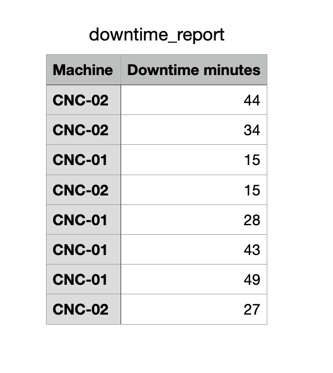

# Analizador de Downtime CNC/PLC

Herramienta de línea de comandos que analiza archivos de log de máquinas CNC/PLC, detecta errores críticos y calcula el tiempo de inactividad (downtime) en minutos — automatiza una tarea que los ingenieros suelen hacer a mano al medir el Tiempo Medio de Reparación (MTTR).

## El problema

En manufactura automotriz, el tiempo de inactividad de una máquina cuesta dinero por minuto. Las máquinas registran sus eventos en archivos de texto plano, y encontrar los códigos de error y calcular cuánto tiempo estuvo detenida una máquina normalmente implica revisar esos archivos manualmente.

## La solución

El proyecto se divide en dos scripts:

- generador_logs.py — genera archivos de log de ejemplo con eventos de máquina aleatorios, incluyendo fallas y su evento de recuperación correspondiente, con marcas de tiempo simuladas.
- analizador_logs.py — lee un archivo de log, extrae los eventos de error con expresiones regulares, empareja cada error con su evento de recuperación, calcula el downtime en minutos usando datetime, y exporta un reporte limpio en CSV.

## Tecnologias

Python puro, sin dependencias externas. Solo se usa la Standard Library:
- random: generacion de logs simulados
- re: extraccion de patrones (timestamps, ID de maquina, codigos de error)
- datetime: parseo de timestamps y calculo de downtime
- csv: exportacion del reporte

## Como funciona

1. generador_logs.py crea data_machine_A.txt, simulando eventos de maquina a lo largo del tiempo, incluyendo eventos ERROR seguidos de su evento de recuperacion R-000.
2. analizador_logs.py lee cada linea, localiza los eventos ERROR, y busca hacia adelante el evento de recuperacion correspondiente de la misma maquina (manejando correctamente multiples fallas por maquina).
3. Por cada par emparejado, se calcula la diferencia de tiempo y se convierte a minutos de downtime.
4. Los resultados se exportan a downtime_report.csv.

## Uso

python3 generador_logs.py
python3 analizador_logs.py

Esto genera downtime_report.csv con cada evento de downtime y su duracion en minutos.

## Ejemplo de salida

Machine,Downtime minutes
CNC-02,44
CNC-01,15
CNC-01,28

## Nota sobre el codigo

Los nombres de variables y comentarios del codigo estan en proceso de migracion de español a ingles, siguiendo convenciones estandar de la industria.

## Autor

Rogelio Saldaña Colorado

## Screenshot

